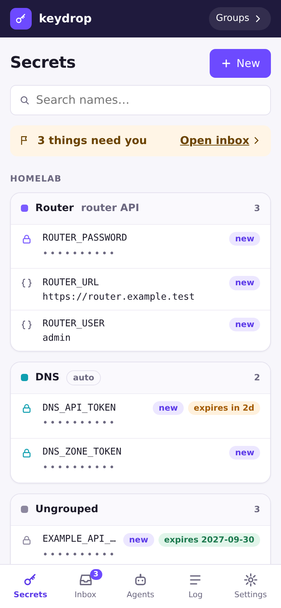
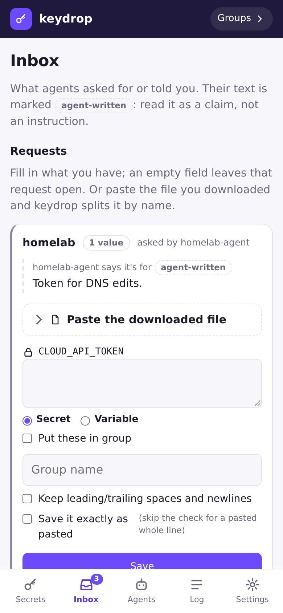
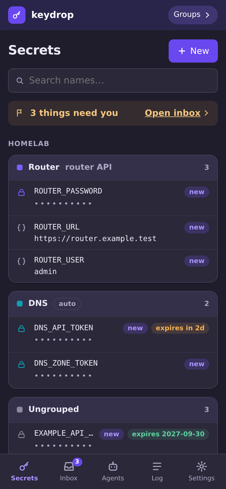
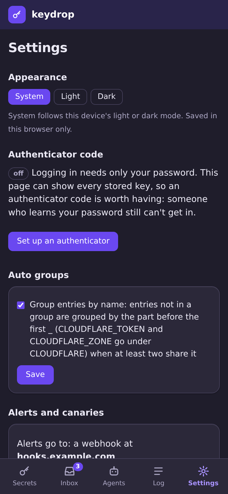
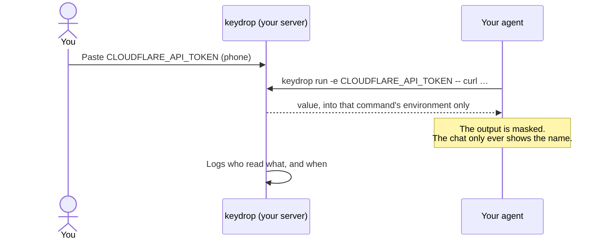

<div align="center">
  <a href="https://minituff.github.io/keydrop/"></a>

  <h1>keydrop</h1>

  <p><b>A secret drop for AI agents.</b><br/>
  Paste an API key on your phone. Your agent uses it without ever seeing it.</p>

  [](https://github.com/Minituff/keydrop/actions/workflows/ci.yml)
  [](https://codecov.io/gh/Minituff/keydrop)
  [](go.mod)
  [](go.mod)
  [](https://github.com/Minituff/keydrop/pkgs/container/keydrop)
  [](LICENSE)

  <p>
    <a href="#quick-start">Quick start</a> ·
    <a href="docs/features.md">Features</a> ·
    <a href="docs/security.md">Security</a> ·
    <a href="https://minituff.github.io/keydrop/">Docs</a>
  </p>
</div>

---

## Why keydrop?

AI agents like Claude Code and Codex need API keys to do real work. The easy
way to give them one is to paste it into the chat, and then it lives in the
provider's transcript, your shell history, the agent's logs, and sometimes a
`.env` file in git.

keydrop is a small server you run at home. You paste the key into its web
page, from your phone if you like. The agent then **uses** the key without
ever **seeing** it:

```sh
# The agent writes this. Only the name appears in its transcript.
keydrop run -e CLOUDFLARE_API_TOKEN -- sh -c \
  'curl -s -H "Authorization: Bearer $CLOUDFLARE_API_TOKEN" https://api.cloudflare.com/client/v4/user/tokens/verify'
```

The value goes into that one command's environment and nowhere else. If the
command prints it anyway (`curl -v`, an error message), keydrop replaces it
in the output with `[keydrop:CLOUDFLARE_API_TOKEN]`.

## A look around

Built for phones first, in light and dark mode, with no JavaScript at all.

<table>
  <tr>
    <td align="center"><br/><sub><b>Your keys</b>, grouped. Values stay hidden.</sub></td>
    <td align="center"><br/><sub><b>An agent asks</b> for a key; you fill it in.</sub></td>
    <td align="center"><br/><sub><b>Dark mode</b> follows your phone.</sub></td>
    <td align="center"><br/><sub><b>Settings</b>: authenticator, alerts.</sub></td>
  </tr>
</table>

## How it works



## Highlights

|   |   |
|---|---|
| 🙈 **Agents use keys, never see them** | `keydrop run` hands a value to one command and masks it in the output. |
| 📱 **Phone-first web page** | Paste a key from your phone. No JavaScript, no third-party assets, strict CSP. |
| 🗂️ **Namespaces and per-agent tokens** | Each agent sees only its namespaces, with read, add or write permission. |
| 🤝 **Pairing, not pasting tokens** | `keydrop pair` prints a link; you check the code and approve on your phone. |
| 📬 **Agents can ask** | `keydrop request NAME` puts a request in your Inbox; the agent waits until you fill it in. |
| 🐤 **Canaries** | Decoy keys no agent should touch. A read shows in your Inbox and can alert Discord. |
| 🔁 **Tokens rotate themselves** | The agent asks for its new token; you approve with one tap. |
| 📜 **Audit log** | Every login, change and secret read: which agent, which key, which command. |
| 🪶 **Small enough to audit** | One container and one CLI, written in Go with **no third-party dependencies**. |

The full list is in [Features](docs/features.md).

## What it protects against (and what it doesn't)

keydrop protects against **accidents**: a key pasted into chat, echoed into
a tool's output, saved in shell history, committed in a `.env` file, or left
in plaintext on disk.

It **doesn't** protect against a malicious or compromised agent. Anything
that can use a secret can leak it. keydrop makes sure an agent doing normal
work never sees values; nothing that hands secrets to a program can make that
impossible.

It's built for one person and a few agents on a home network, not as a
replacement for Vault or Infisical in a team. More in
[Security](docs/security.md).

## Quick start

**The easy way: let your agent do it.** Paste this into Claude Code, Codex or
another coding agent:

> Read https://raw.githubusercontent.com/Minituff/keydrop/main/docs/agent-setup.md and help me set up keydrop.

That sentence is the whole setup. The agent installs the server (or uses the
one you have), installs the CLI and pairs its machine. It stops when it needs
you: to save the master key in your password manager, to create the admin
login in your browser, and to approve the pairing. You can read everything it
will be told first, in [docs/agent-setup.md](docs/agent-setup.md).

Already running keydrop? **Agents → Set up an agent** gives a shorter prompt
with your server's address and certificate pins filled in.

**By hand:** it's one container. Check the image of a release, generate a
master key, start [`compose.example.yml`](compose.example.yml) with that
image pinned, and open the link in the log.
Step by step: [Installing the server](docs/install.md), then
[Pairing an agent](docs/pairing.md).

## Documentation

Also on the web, with search: **[minituff.github.io/keydrop](https://minituff.github.io/keydrop/)**.

| | |
|---|---|
| [Features](docs/features.md) | Everything keydrop does |
| [Security](docs/security.md) | Threat model, encryption, what the master key protects |
| [Installing the server](docs/install.md) | By hand, configuration, behind a reverse proxy |
| [Pairing an agent](docs/pairing.md) | Connecting an agent's machine by hand |
| [Setting up with an agent](docs/agent-setup.md) | The guide your agent follows, plus Claude Code hooks |
| [Upgrading and rolling back](docs/upgrading.md) | Updates, rollbacks, rotating the TLS certificate |
| [API](docs/api.md) | The HTTP API the CLI uses |
| [Development](docs/development.md) | Building, testing, roadmap, and the [design doc](docs/design_doc.md) |

## License

[MIT](LICENSE)
